<p align="center"></p>

# Sunbird

A local web dashboard for a Sigenergy **SigenStor**. It reads the SigenStor directly over
Modbus TCP on your home network. It needs no cloud and no account, and it refreshes every 5 seconds.

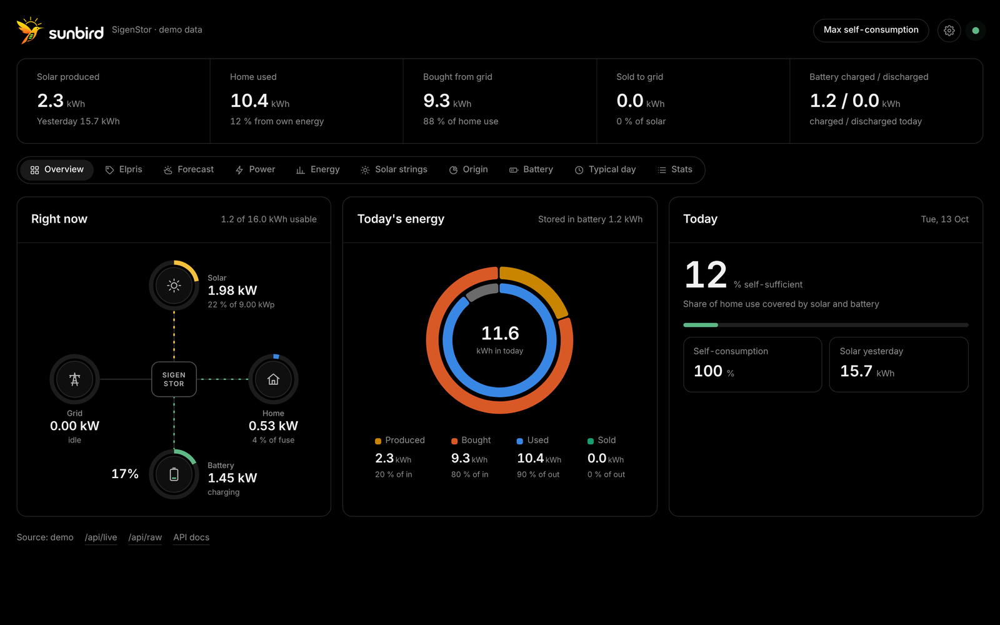

- **Right now:** live power flow between solar, grid, home and battery. The numbers roll when they change.
  Rings show solar output against your panels' peak, grid and home use against your main fuse, and the battery level.
- **Today:** solar produced, home used, bought and sold, battery in and out, and self-sufficiency, plus a donut of today's energy.
- **Elpris:** Nord Pool spot prices for SE1–SE4 from [elprisetjustnu.se](https://www.elprisetjustnu.se), free.
  - Shown as 15-minute or hourly bars, coloured green, orange or red by price.
  - Moms, överföringsavgift and other costs can be added.
  - The battery and grid activity can be shown on top.
  - A second chart shows buying price, selling price and battery level together, so you can see when the battery charged and discharged.
- **Forecast:** expected solar output per string for today and tomorrow, from [Forecast.Solar](https://forecast.solar) (free, no account).
  - Actual production is drawn on top.
  - A forecast-vs-actual history shows how accurate the forecast has been.
- **Power:** all series, or one at a time, from 1 hour to 30 days.
- **Energy:** solar, home, bought, sold, charged and discharged per hour, day, week or month, with an all-time-high line.
- **Solar strings:** PV1–PV4 as lines (power, voltage or current), or produced kWh as bars.
- **Origin:** where the home's energy came from (solar, battery or grid), and how much was bought vs sold.
- **Battery:** battery level, and temperature for the hottest pack, the average cell and the coolest pack.
- **Typical day:** average solar and home use for each hour of the day.
- **Stats:** battery life (full cycles used out of the rated cycles), health, cell data and system info.
- English, Swedish, German, French and Spanish, with smooth or straight chart lines. It works on phones too.

Sunbird only **reads** from the SigenStor. It never writes to it.

## Screenshots

All screenshots use the built-in demo data.

| | |
|---|---|
| 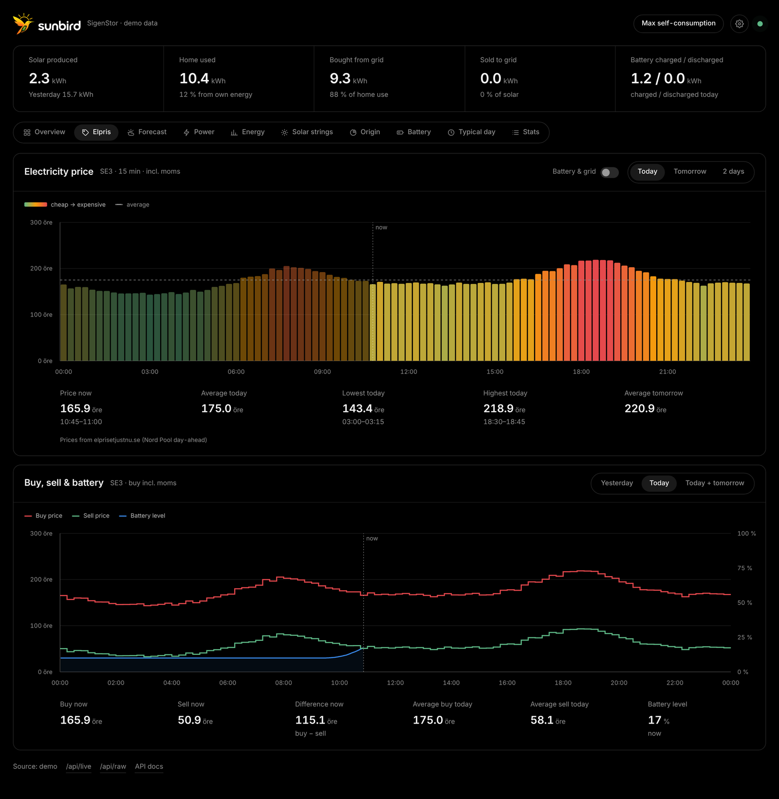 **Elpris:** spot price, buy/sell price and battery level | 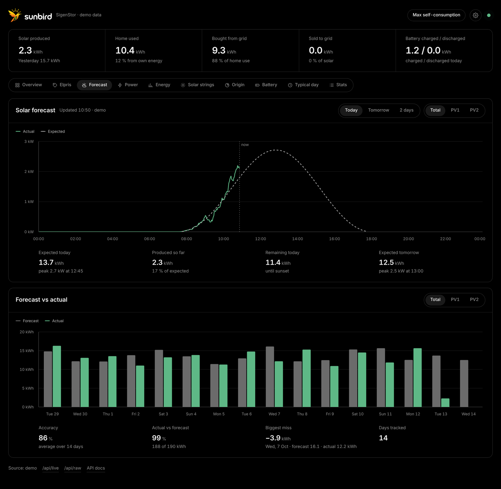 **Forecast:** expected vs actual solar |
| 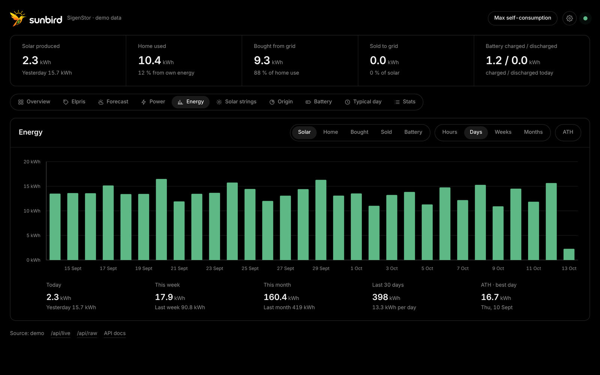 **Energy** per day, week or month | 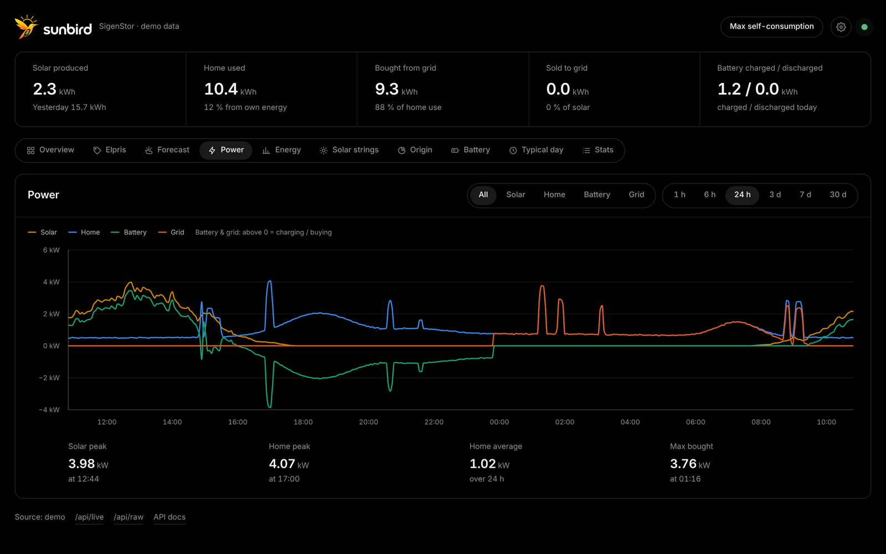 **Power** over time |
| 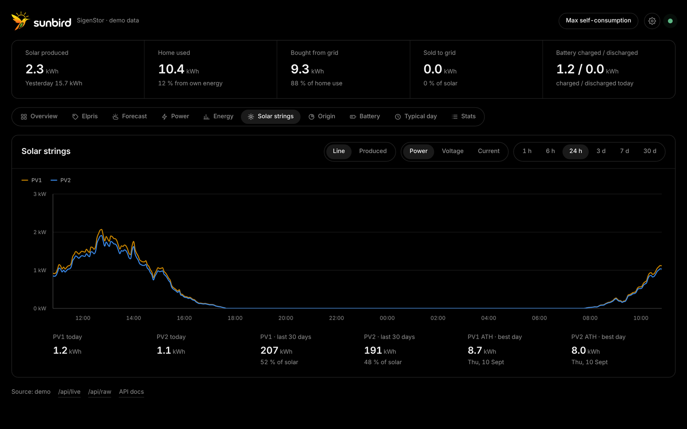 **Solar strings** compared | 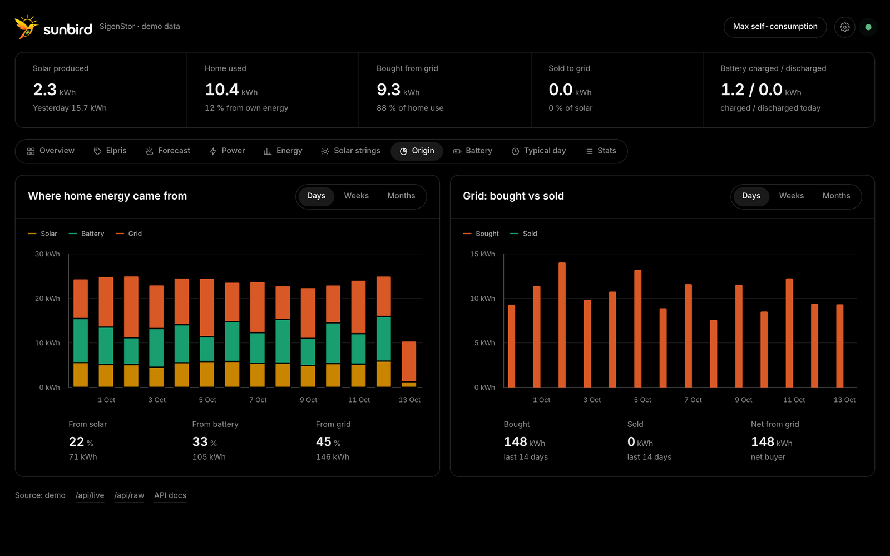 **Origin:** where home energy came from |
| 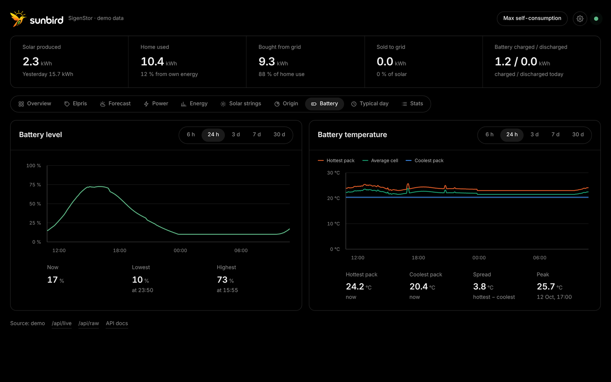 **Battery** level and temperature | 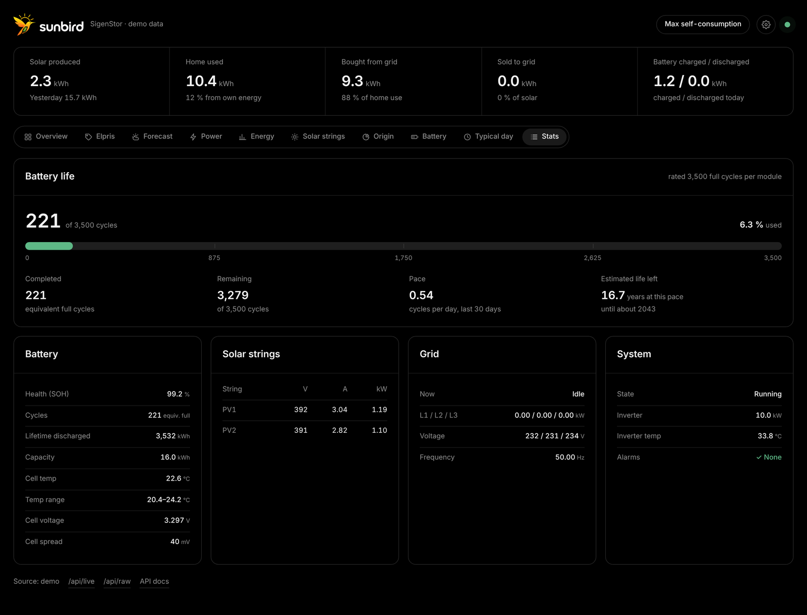 **Stats:** battery life and system details |
| 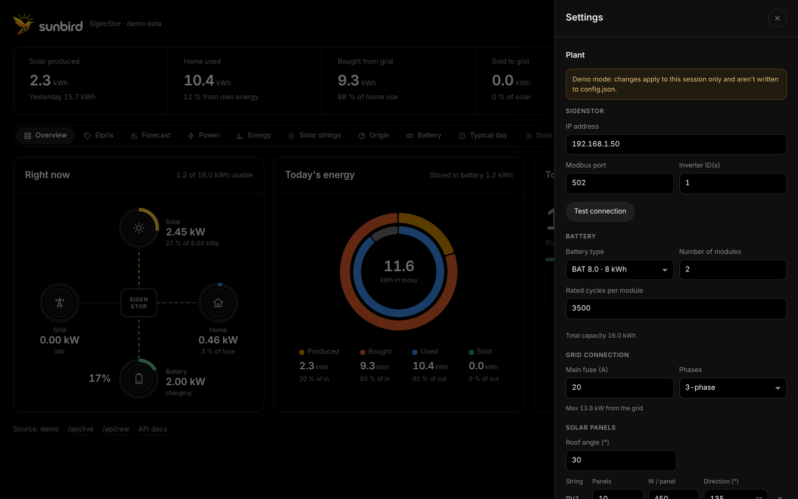 **Settings:** set up your plant from the browser | 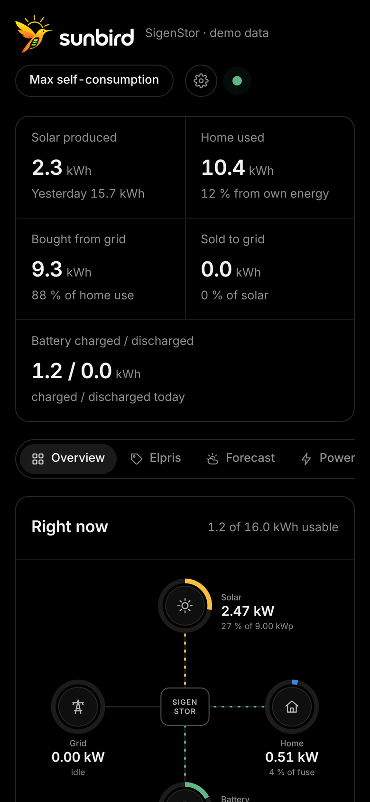 **On a phone** |

## Requirements

- A SigenStor with **Modbus-TCP enabled**. This is usually done by your installer in the Sigen installer app, and they must press **Save** after turning it on.
- A computer on the same network with **Python 3.9+**, such as a Mac, Linux box or Raspberry Pi.
- Recommended: give the SigenStor a fixed IP address (a DHCP reservation in your router).

## Install and run

```bash
git clone https://github.com/b00lt/sunbird.git
cd sunbird
./run.sh
```

The first run creates a `.venv` and installs three packages.

Open **http://localhost:8742**. The terminal also prints the address to use from your phone.

On first start the dashboard asks you to open **⚙ Settings → Plant** and fill in:

| | |
|---|---|
| **SigenStor** | IP address and Modbus port (502). **Test connection** checks the link and finds your inverter ID. |
| **Battery** | module type (BAT 5.0 / 8.0 / 9.0 or other), number of modules, rated cycles (3500 by default) |
| **Solar panels** | roof angle, then for each string (PV1–PV4): number of panels, watts per panel and the direction they face (90 = east, 180 = south, 270 = west) |
| **Location** | search for your town or use the device's location. Only two decimals are kept, which is about 1 km. |

Click **Save**. Sunbird connects straight away and writes everything to `config.json`.

You can test the connection from the terminal too: `./run.sh --check 192.168.1.50`.

### Other ways to run it

| command | what it does |
|---|---|
| `./restart.sh` | (re)starts Sunbird in the background. Output goes to `sunbird.log`. |
| `./restart.sh --stop` | stops it |
| `./run.sh --demo` / `./restart.sh --demo` | runs against a simulated SigenStor with two weeks of made-up history, stored in `sunbird-demo.db` |

`restart.sh` only stops a Sunbird started from the same folder. It finds it by its PID file and process, and never touches anything else.

### Docker

```bash
git clone https://github.com/b00lt/sunbird.git
cd sunbird
docker compose up -d --build
```

Settings and history are kept in `./data` (`config.json` and `sunbird.db`), so they survive rebuilds.
Set `TZ` in `docker-compose.yml` to your time zone so "today" starts at your midnight.
To update: `git pull && docker compose up -d --build`.

## config.json

Everything under **Plant** is edited from the dashboard. A few server settings can only be set by hand; see `config.example.json`.

| key | default | meaning |
|---|---|---|
| `http_port` | `8742` | dashboard port |
| `poll_seconds` | `5` | how often live values are read |
| `store_seconds` | `30` | how often a history point is saved |
| `retention_days` | `730` | how long history is kept in `sunbird.db` (about 30 MB per year) |
| `plant_unit` | `247` | Modbus device ID of the whole plant (Sigenergy standard) |
| `inverter_units` | `[1]` | inverter device ID(s). If you have a Sigen AC charger, it often takes ID 1 and the inverter is 2. |

Simple keys can also be set as environment variables, for example `SUNBIRD_HOST=192.168.1.50` or `SUNBIRD_HTTP_PORT=9000`.
`SUNBIRD_CONFIG` points to a different config file.

Forecast.Solar's free tier allows about 12 calls per hour. Sunbird makes one call per string every 60 minutes, which stays well within that.

## How the numbers work

- **Live power** comes from the plant registers (device 247):
  - PV
  - battery: + is charging, − is discharging
  - grid: + is buying, − is selling
  - home load

  On older firmware without a load register, home load is calculated as system AC output + grid + third-party PV.
- **Daily energy** is the difference in the SigenStor's lifetime counters since midnight. It stays correct even if Sunbird was restarted during the day.
- **Battery cycles** = lifetime discharged ÷ total capacity, which equals the full cycles each module has done.
- **Battery temperature:** Modbus only reports the hottest pack, the coolest pack and the average cell, not each pack.
- **Unsupported registers:** registers your firmware doesn't support are detected on the first read and skipped.

## API

| endpoint | returns |
|---|---|
| `/api/live` | current snapshot and today's totals |
| `/api/stream` | the same, pushed on every poll (Server-Sent Events) |
| `/api/history?hours=24` | averaged power and SOC series |
| `/api/energy?group=day&n=30` | kWh per hour, day, week or month, incl. PV1–PV4 and home-energy sources (`n=0` = all) |
| `/api/prices?zone=SE3` | spot prices (SEK/kWh excl. moms) for yesterday, today and tomorrow |
| `/api/forecast` | forecast curve for today and tomorrow, and forecast vs actual per day |
| `/api/profile?days=30` | average solar and home power for each hour of the day |
| `/api/config` | plant settings (GET / POST) |
| `/api/raw` | every register value as read, useful for debugging |
| `/docs` | interactive API docs |

## Project layout

```
sunbird/app.py            poller, web server, settings API
sunbird/registers.py      Sigenergy Modbus register map (subset)
sunbird/modbus_client.py  block reads that skip unsupported registers automatically
sunbird/derive.py         turns raw registers into a dashboard snapshot
sunbird/store.py          SQLite history and energy totals
sunbird/forecast.py       solar forecast per string (Forecast.Solar)
sunbird/prices.py         Nord Pool spot prices (elprisetjustnu.se)
sunbird/simulator.py      SigenStor model for --demo
web/index.html            the dashboard (no build step; React and Recharts are vendored in web/vendor)
tools/check_connection.py connection test
tools/fake_sigenstor.py   fake Modbus server for development
```

The register map is based on the Sigenergy Modbus protocol as implemented in the open-source
[Sigenergy-Local-Modbus](https://github.com/TypQxQ/Sigenergy-Local-Modbus) Home Assistant integration.

Not affiliated with Sigenergy.
